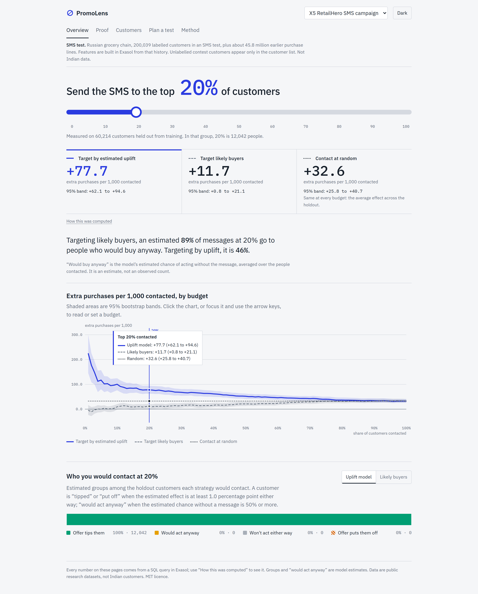
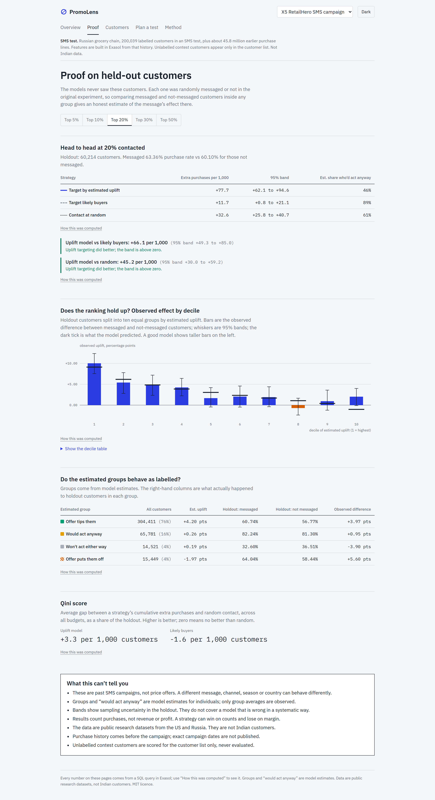
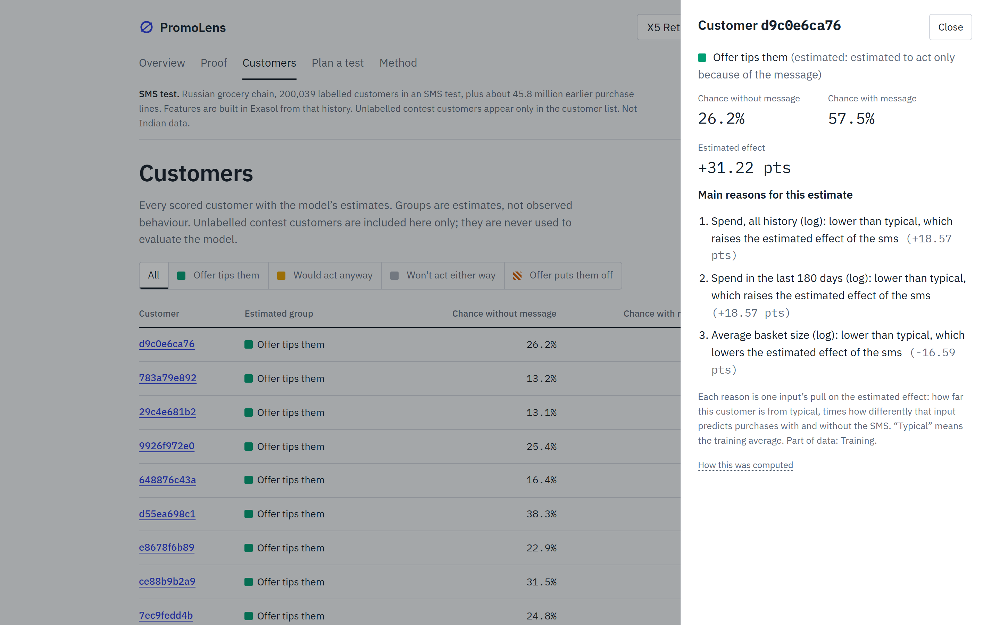
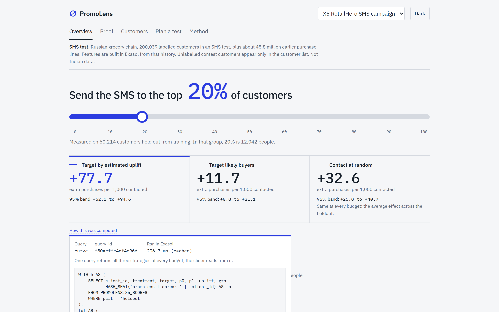
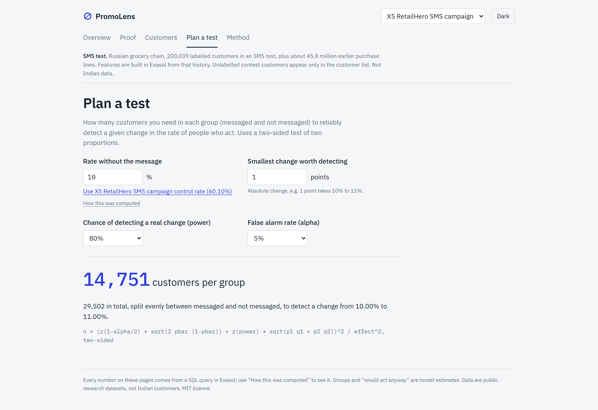

# PromoLens

**Message the customers an offer actually changes, and stop paying to reach people who would have bought anyway.**

PromoLens trains on real randomised campaign experiments, scores every customer inside
Exasol, and proves on held-out customers that targeting by "who is moved" beats contacting
everyone or contacting the likeliest buyers.

Built for ExaThon India 2026, Track 02 (Customers, Channels & Demand).

- Pitch deck: [docs/PromoLens-pitch.pdf](docs/PromoLens-pitch.pdf) 
- Licence: MIT



## The problem

**Who has it.** CRM and marketing teams at retailers and consumer brands. They send SMS,
WhatsApp and email campaigns to millions of customers and usually choose the audience by who
is *likely to buy*.

**What goes wrong.** Likely buyers are often the people who would have bought without the
message. On the X5 grocery test, the model estimates that 89% of messages sent to the
likeliest buyers (top 20%) go to people who would have bought anyway. Those messages add
send volume, customer fatigue and opt-outs, and little else.

**Why it matters.** Reach is limited. It should go to customers the message changes, and a
team needs evidence, not a promise, that it does.

**The idea.** Customers fall into four kinds: the offer tips them, they would act anyway,
they won't act either way, or the offer puts them off. A randomised experiment shows the
average effect of a message. PromoLens learns which customers have the biggest effect, ranks
by that (uplift = chance with the message minus chance without), and checks the ranking on
customers the model never saw.

## Results

Everything below is measured on the 30% of customers held out from training. "Extra per 1,000"
is the extra outcomes per 1,000 customers contacted (messaged minus not-messaged rate, among
the top 20% of the ranking). Bands are 95% bootstrap bands (200 resamples, fixed seed).

| Dataset | Uplift model | Likely buyers | Random | Uplift minus likely buyers | Uplift minus random |
|---|---|---|---|---|---|
| X5 RetailHero (purchases) | **+77.7** [+62.1, +94.6] | +11.7 [+0.8, +21.1] | +32.6 [+25.8, +40.7] | +66.1 [+49.3, +85.0] better | +45.2 [+30.0, +59.2] better |
| Lenta (store visits) | **+16.8** [+9.1, +26.0] | +8.4 [-1.1, +20.8] | +8.4 [+5.6, +11.7] | +8.4 [-0.6, +17.6] inconclusive | +8.4 [+2.1, +16.2] better |
| Hillstrom (purchases) | +7.9 [+2.4, +13.8] | +8.1 [+2.1, +14.2] | +6.5 [+4.1, +8.8] | -0.3 [-5.7, +4.2] inconclusive | +1.4 [-3.5, +6.3] inconclusive |

"Better" means the 95% band is above zero. "Inconclusive" means it includes zero; the app
says so on screen.

**X5 in detail.** Targeting by uplift gave +117 extra purchases per 1,000 at the top 5%,
+100 at 10%, +78 at 20%, +68 at 30% and +52 at 50%, against a flat +32.6 for random contact.
The estimated share of contacted customers who would have bought anyway is 46% when
targeting by uplift and 89% when targeting likely buyers. The decile table confirms the
ranking: the observed effect of the SMS in the top decile is +10.0 points (band +7.6 to
+12.4) against +9.1 estimated, and it falls as the estimated uplift falls.



### Model benchmark

Five-fold out-of-fold Qini on the Lenta *training* split only (the holdout was not used):

| Model | Qini | Extra visits per 1,000 at 20% | Scores in Exasol with `EXP` |
|---|---|---|---|
| Two-model logistic (shipped) | +0.0096 | +10.2 | yes |
| Interaction logistic | +0.0096 | +12.3 | yes |
| Binned features + logistic (5 bins) | +0.0095 | +13.0 | yes |
| Binned features + logistic (8 bins) | +0.0062 | +11.4 | yes |
| Boosted trees (offline reference) | +0.0118 | +14.6 | no |
| Likely buyers (rank by p1) | +0.0056 | +7.8 | yes |

We kept the two-model logistic: it ties the best alternatives that Exasol can score, ranks
above likely buyers on Qini in cross-validation, and scores entirely in SQL.

### Correctness checks

- **SQL vs scikit-learn parity:** max difference 2.0e-14 on 60,214 X5 holdout customers
  (tolerance 1e-6). `pipeline.train` prints it; `tests/test_parity.py` enforces it.
- **Tests:** 30 pass (`pytest`), `ruff check` clean.
- **Cross-check:** `pipeline.evaluate` also prints scikit-uplift's `qini_auc_score`.

## What was built, end to end

1. **Load.** Three public randomised campaign datasets go into typed Exasol tables. X5's
   45.8M purchase lines stream in through pyexasol in 256 MB chunks (never into pandas), with
   row counts printed and checked.
2. **Features, in SQL.** X5: recency, 30/90/180-day and all-time counts and spend, basket
   size, distinct stores, products and categories, own-brand and alcohol share, points
   received and spent, express-points share, tenure, redeemed flag, age, gender (25 features,
   built from 8.0M transaction rows in about 70 s, in 16 buckets to fit the container's
   memory). Lenta: 33 features. Hillstrom: 9.
3. **Split.** A deterministic 70/30 split by salted SHA1 of `client_id`, computed in SQL and
   stored in `<DS>_SPLIT`. Fitting and tuning use the 70% only.
4. **Train.** Two L2 logistic regressions, one on messaged customers (p1) and one on the
   rest (p0), on standardised, median-filled inputs. C is chosen from {0.01, 0.1, 1} by
   3-fold CV log loss inside the training split. `uplift = p1 - p0`.
5. **Score in Exasol.** Coefficients, means, stds and fill values go to `<DS>_MODEL_COEF`.
   A SQL view (`backend/sql/20_scores.sql`) computes z-scores, `p0`, `p1` and `uplift` with
   `EXP` for every customer. X5's 400,162 customers score in 2.3 s.
6. **Evaluate on the holdout.** Three strategies at every top-k%: uplift model, likely buyers
   (rank by p1) and random. Metrics are computed in SQL: extra outcomes per 1,000 contacted,
   the estimated share who would act anyway, a decile table, the Qini coefficient and four
   estimated groups.
7. **Quantify uncertainty.** 200 bootstrap resamples of the scored holdout give 95% bands on
   every curve and headline.
8. **Serve.** FastAPI plus a React UI. Every number carries its SQL, a `query_id` and its
   runtime.



## What you see

| Screen | What it answers |
|---|---|
| Overview | Drag "send to the top N%": extra outcomes per 1,000 contacted for three strategies, with bands, plus who you would be contacting |
| Proof | Head-to-head on the holdout, observed effect by decile, whether the estimated groups behave as labelled |
| Customers | Every scored customer, filterable by estimated group, with three plain-language reasons per estimate |
| Plan a test | Customers needed per arm to detect a given change |
| Method | The method, the data and the assumptions in plain language |

Every number comes from a SQL query in Exasol. Each one has a "How this was computed" link
showing the SQL, its `query_id` (sha1 of the SQL text) and how long it ran in Exasol. Queries
are also logged to `PROMOLENS.QUERY_LOG`. pyexasol exposes the session id but no per-statement
id, so the log stores the session id.



More screenshots in [docs/screenshots/](docs/screenshots/): Lenta and Hillstrom overviews,
Lenta proof, customer list, plan-a-test, method, dark theme and a 390 px phone layout.

## Method details

- **Metrics at top k% contacted.** Extra outcomes per 1,000 = `(Yt/Nt - Yc/Nc) * 1000` among
  the top k% (Yt, Yc outcomes and Nt, Nc customers messaged and not messaged). Share who
  would act anyway = mean model `p0` of those contacted (an estimate). Qini: average gap
  between a strategy's cumulative curve and the random line on the 1% grid, as a share of the
  holdout.
- **Random strategy.** The expected result of picking k% at random: the whole-holdout effect.
- **Bootstrap.** Rankings are fixed; rows are resampled with replacement; 95% percentile
  bands; fixed seed 20260131. Resampling runs in Python on scores fetched from Exasol; the
  bands are written to `<DS>_BOOTSTRAP` and joined into the metric queries.
- **Four estimated groups.** Offer tips them: uplift >= u. Offer puts them off: uplift <= -u.
  Otherwise would act anyway if p0 >= 0.5, else won't act either way. Default u = 0.01 (1
  percentage point); thresholds are set per dataset in `backend/app/config.py`.
- **Plan a test.** Sample size per arm for a two-sided two-proportion z-test:
  `n = (z(1-a/2) sqrt(2 pbar qbar) + z(power) sqrt(p1 q1 + p2 q2))^2 / effect^2`.



## Data and scope

- **Datasets.** X5 RetailHero (SMS, grocery chain, 200,039 labelled customers plus 45.8M
  purchase lines), Lenta (SMS, grocery chain, 687,029 customers, outcome is a store visit) and
  Hillstrom (email, online retailer, 64,000 customers). All are public research datasets from
  Russia and the US.
- **Campaign type.** The campaigns are SMS and email messages, not price discounts, and the
  app uses "message" or "offer" throughout.
- **Estimates.** Groups and "would act anyway" are model estimates and are labelled that way.
  Only group averages are observed from the experiment.
- **Counts and rates only.** No currency or revenue figures appear anywhere.
- **Unlabelled customers.** X5's `uplift_test.csv` has no labels. It is scored only to
  populate the customer list and never used for evaluation.

## Setup

Requirements: Windows, macOS or Linux; Python 3.11; Node 20+; Docker.

```bash
# 1. Python env (one venv at the repo root)
python -m venv venv
venv\Scripts\activate          # macOS/Linux: source venv/bin/activate
pip install -r backend/requirements.txt

# 2. Exasol (skip if you already run one)
docker run --name exasoldb -p 9563:8563 --detach --privileged --stop-timeout 120 exasol/docker-db:latest
docker logs exasoldb --tail 100        # wait until initialisation has finished

# 3. Connection settings
copy .env.example .env         # macOS/Linux: cp .env.example .env
# Fill in EXA_USER / EXA_PASSWORD for your container, and the TLS certificate
# fingerprint in EXA_DSN (localhost/<FINGERPRINT>:9563). DBeaver shows the
# fingerprint when you first connect. Pinning it keeps TLS verification on.

# 4. Check everything
cd backend
python -m pipeline.doctor
```

The development container here was started with those flags and has **no volume mounts**, so
its data lives in the container's writable layer. `docker rm` deletes the database; stopping
and starting it is safe. To keep data across re-creation, add a volume (see the
`exasol/docker-db` documentation). Check the image documentation for edition-specific limits
before relying on them.

## Data steps

| Dataset | How to get it | Where |
|---|---|---|
| Hillstrom | `python -m pipeline.download --dataset hillstrom` (scikit-uplift) | `data/Hillstrom/` |
| Lenta | `python -m pipeline.download --dataset lenta` (about 145 MB) | `data/Lenta/` |
| X5 RetailHero | Download the RetailHero uplift contest files by hand (about 4.5 GB unpacked) | `data/X5-RetailHero/` with `clients.csv`, `products.csv`, `purchases.csv`, `uplift_train.csv`, `uplift_test.csv` |

`data/` is gitignored and never committed. `purchases.csv` is never read into pandas:
`pipeline.load` streams it into Exasol in 256 MB chunks through pyexasol's HTTP transport and
checks the row count.

## Run guide

From `backend/` with the venv active:

```bash
python -m pipeline.all --dataset hillstrom      # load, features, train, bootstrap, evaluate
python -m pipeline.all --dataset lenta
python -m pipeline.all --dataset x5             # the purchases import takes a while

# or step by step
python -m pipeline.load      --dataset x5
python -m pipeline.features  --dataset x5
python -m pipeline.train     --dataset x5
python -m pipeline.bootstrap --dataset x5
python -m pipeline.evaluate  --dataset x5

python -m pipeline.run_sql --dataset lenta --print 20_scores.sql   # see rendered SQL
```

Re-running a step rebuilds that dataset's tables in the `PROMOLENS` schema; nothing outside
that schema is touched.

Development servers (two terminals):

```bash
cd backend  && uvicorn app.main:app --reload      # http://127.0.0.1:8000/docs
cd frontend && npm install && npm run dev         # http://localhost:5173
```

Tests:

```bash
cd backend
python -m pytest -m "not db"    # formulas, SQL templates, API without a database
python -m pytest                # also SQL-vs-sklearn parity and live API checks
python -m ruff check .
```

## Deployment

The app is one process: FastAPI serves the API and, when `frontend/dist` exists, the built UI.
Exasol runs separately and holds the data.

**Option A: build and run directly**

```bash
cd frontend && npm install && npm run build       # creates frontend/dist
cd ../backend && uvicorn app.main:app --host 0.0.0.0 --port 8000
# open http://localhost:8000
```

**Option B: Docker image**

```bash
docker build -t promolens-app .
docker run -d -p 8000:8000 --env-file .env promolens-app
# open http://localhost:8000
```

Inside a container, `localhost` is the container itself. Point `EXA_DSN` at where Exasol is
reachable and keep the fingerprint, for example
`EXA_DSN=host.docker.internal/<FINGERPRINT>:9563` when Exasol runs on the Docker host, or the
Exasol container's name on a shared Docker network. The pipeline (loading and training) runs
once from the repository, not from the app image; the app only reads the scored tables.

Checklist for a new environment: Exasol reachable and initialised, `.env` filled in, `python
-m pipeline.doctor` passes, `python -m pipeline.all --dataset <id>` run for each dataset you
want to show, then `GET /api/health` returns `exasol: true` with the expected tables.

Never commit `.env`. Secrets are read from the environment only.

## Layout

```
backend/app/        FastAPI app: config (dataset adapters), db, routers, services, schemas
backend/pipeline/   doctor, download, load, features, train, bootstrap, evaluate, run_sql, all
backend/sql/        numbered, idempotent SQL templates ({{P}} = dataset prefix)
backend/tests/      pytest; -m db marks tests that need Exasol
frontend/src/       React pages, custom SVG charts, plain CSS
docs/               pitch deck, screenshots, design plan, tools to rebuild them
Dockerfile          app image (API + built UI)
```

Adding a dataset means one `Dataset` entry in `backend/app/config.py`, a raw-table SQL file,
a frame SQL file and a loader function. The API and UI need no changes.

Rebuild the screenshots and the deck (API on :8000, frontend on :5173):

```bash
pip install playwright python-pptx
python docs/tools/shots.py          # needs Google Chrome installed
python docs/tools/build_deck.py     # numbers are read from the API
```

## Licence and data terms

Code: MIT (see `LICENSE`). Datasets are not redistributed here; each keeps its own terms.
Hillstrom: published by Kevin Hillstrom (MineThatData) for analysis. Lenta and X5: released
for research and competition use and distributed via scikit-uplift and the RetailHero
contest. Check each source's terms before commercial use.
